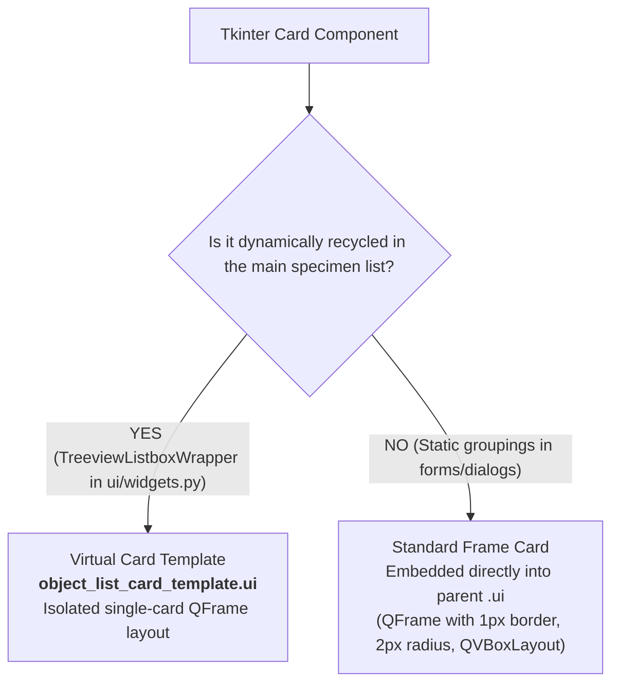

# Master PySide6 UI Extraction Plan (Phase 1)
**Document Version:** 1.0.0  
**Phase:** 1 (Strict 1:1 Visual and Structural UI Extraction)  
**Target Output Directory:** `pyside_new_uis/`  
**Status:** Pending User Approval  

---

## 1. Executive Summary & Objective Confirmation

### 1.1 Phase 1 Mission
The objective of Phase 1 is to achieve a **strict 1:1 visual and structural extraction** of Arbor's existing Tkinter user interface into modern PySide6 declarative `.ui` XML files (Qt Designer format).

### 1.2 Boundary Conditions & Strict Constraints
During Phase 1, the following operational boundaries are strictly enforced:
* **No Logic Wiring:** Python controllers, signal/slot wiring to backend databases, and EventBus integrations will NOT be implemented during this phase. That belongs to Phase 2.
* **No UX Redesign:** Workflows, button placements, form structures, and interaction paradigms will NOT be altered or combined. Layouts must reflect the exact current Tkinter visual structure.
* **Isolation in `pyside_new_uis/`:** All newly generated `.ui` files will be placed exclusively into `pyside_new_uis/`. The existing production and legacy UI directories remain untouched.
* **Total Independence from Existing `.ui` Files:** Any existing `.ui` files in the repository (e.g. in `qt designer/` or `ui_qt/`) are completely ignored. Every new `.ui` file is built cleanly from the ground up using the Tkinter codebase (`ui/`) as the single source of truth.
* **Property Encodings Compliance:** In Qt `.ui` XML files, cursor properties must strictly use `<cursorShape>CursorName</cursorShape>` (e.g. `<cursorShape>PointingHandCursor</cursorShape>`) instead of invalid `<enum>Qt::CursorName</enum>` constructs, preventing `QUiLoader` parser crashes.
* **Mandatory QUiLoader Verification:** Every generated `.ui` file must immediately be verified with `python scripts/verify_ui.py pyside_new_uis/<filename>.ui` (executed with `QT_QPA_PLATFORM=offscreen` if required) before being considered complete.

---

## 2. Design System & Visual Translation Rules

All `.ui` files will replicate the tokens and design philosophy defined in `documentation/agent/AI_UI_GUIDE.md`.

### 2.1 Color Palette Tokens

| Token | Hex Value | Qt UI Usage |
| :--- | :--- | :--- |
| `SURFACE` / `BACKGROUND` | `#fbfaf8` | Window canvas background, main panel background |
| `SURFACE_DIM` | `#dadada` | Sidebar lists, directory panels, subtle separators |
| `CARD` / `SURFACE_LOWEST` | `#ffffff` | Active card containers, input fields on focus |
| `CONTAINER` / `HEADER_ROW`| `#f2f5f1` | Table headers, secondary containers, card backgrounds |
| `SURFACE_HIGH` | `#e9ece5` | Hover states, segmented toggle backgrounds |
| `TEXT_PRIMARY` | `#2c302e` | Charcoal primary labels, headers, form inputs |
| `TEXT_SECONDARY` / `OUTLINE`| `#757d77` | 1px border lines, subtle labels, placeholder text |
| `BORDER_HAIRLINE` | `#c4c7c7` | Card perimeter outlines, horizontal/vertical dividers |
| `PRIMARY` / `BLACK` | `#000000` | High-emphasis primary action buttons |
| `SECONDARY` / `GREEN` | `#3a7d44` | Vibrant fern: reviewed badges, verification indicators |
| `STATUS_RED` | `#c93a40` | Brick red: problem flags, mandatory badges, error borders |
| `STATUS_YELLOW` | `#d9a036` | Mustard yellow: warnings, unsaved states, pending reviews |
| `STATUS_BLUE` | `#4a7b9d` | Slate blue: historical discrepancies, conflict tags |
| `SEARCH_ORANGE` | `#d95c14` | Query highlights, active filter indicators |

### 2.2 Typography Strategy

| Role | Font Family | Default Size | Usage in `.ui` |
| :--- | :--- | :--- | :--- |
| **Scholarly Serif** | `Lora`, `Georgia` | 16pt / 20pt / 24pt | Specimen scientific name headers, dialog main titles |
| **Systematic Sans** | `Inter`, `Segoe UI`, `Helvetica` | 9pt / 10pt / 12pt | Metadata inputs, field labels, button copy, tabs |
| **Technical Mono** | `JetBrains Mono`, `Consolas` | 8pt / 9pt / 10pt | Specimen IDs, coordinate strings, status badges, shortcuts |

### 2.3 Translating Tkinter `sc()` Scaling to Qt Layouts
In Tkinter, pixel metrics are wrapped in `sc(px)` to handle variable DPI. In Qt Designer `.ui` files:
1. **Dynamic Layout Containers:** We use `QVBoxLayout`, `QHBoxLayout`, and `QGridLayout` with layout margins and spacings set to design-token increments (`margin=12`, `spacing=8`, `margin=4`).
2. **Size Policies & Minimum Dimensions:** Minimum sizes (`minimumSize`) and stretch factors (`layoutStretch`) are defined based on baseline 96 DPI values; Qt's native high-DPI scaling engine handles display resolution adjustments automatically.
3. **Scrollable Canvases:** Any content with dynamic height (forms, long cards, audit lists) is placed inside a `QScrollArea` with `widgetResizable=true` and explicit frame styling.

---

## 3. Handling Cards: Virtual vs. Standard Frame

Arbor uses two distinct card paradigms. They are handled as follows:



### 3.1 Virtual Cards (The Object List)
* **Target File:** `pyside_new_uis/object_list_card_template.ui`
* **Source:** `ui/widgets.py` (`TreeviewListboxWrapper._build_card_dict`)
* **Layout Structure:**
  - Root: `QFrame` (`card_outer_frame`) with `objectName="card_outer_frame"`
  - Left: Accent Strip `QFrame` (`accent_strip`, fixed width 4px) indicating problem/review state.
  - Body: `QFrame` (`card_body_frame`) containing 3 vertical rows:
    - **Row 1 (`QHBoxLayout`):**
      - Checkbox indicator `QLabel` (`lbl_checkbox`, text="☐")
      - Taxon name `QLabel` (`lbl_taxon_name`, Georgia italic bold)
      - Badge container with status chips: `badge_reviewed`, `badge_ukn`, `badge_img`, `badge_loaned`, `badge_unval`
    - **Row 2 (`QHBoxLayout`):**
      - Family label `QLabel` (`lbl_family`)
      - Separator bullet `QLabel` (`lbl_dot`, text="•")
      - Specimen ID `QLabel` (`lbl_specimen_id`, JetBrains Mono / Consolas)
      - Online globe indicator `QLabel` (`lbl_globe`, text="🌐")
      - Photo count label `QLabel` (`lbl_photo_count`, text="📷 0")
    - **Row 3 (`QHBoxLayout`):**
      - Location summary `QLabel` (`lbl_location`, text="", wordWrap=true)

### 3.2 Standard Frame Cards (Static Groupings)
Embedded directly into their parent `.ui` files (e.g. `main_window.ui`, `historical_resolver.ui`).
* **Visual Styling:** `QFrame` with background `#ffffff`, border `1px solid #c4c7c7`, border-radius `2px`, internal padding `8px` or `12px`.
* **Header / Title:** Subtle uppercase label (`QLabel`) overlapping or pinned to the top with `JetBrains Mono` or bold `Inter`.

---

## 4. Master Inventory of Tkinter Windows & Dialogs

Below is the complete inventory of all 32 UI surfaces extracted from the `ui/` codebase.

| # | Window / Dialog Name | Tkinter Source Module | Primary Class / Function | Target `.ui` File | Root Qt Widget |
| :- | :--- | :--- | :--- | :--- | :--- |
| **0** | **Single Object Card Template** | `ui/widgets.py` | `TreeviewListboxWrapper` | `object_list_card_template.ui` | `QFrame` |
| **1** | **Startup & Project Setup** | `ui/dialogs.py` | `StartupDialog` | `startup_dialog.ui` | `QDialog` |
| **2** | **Main Review Workspace** | `ui/main_window.py` | `ObjectProgramUI` | `main_window.ui` | `QMainWindow` |
| **3** | **Quick Peek Specimen Inspector** | `ui/quick_peek.py` | `QuickPeekController` | `quick_peek_dialog.ui` | `QDialog` |
| **4** | **Location Editor Modal** | `ui/main_window.py` | `open_location_window` | `location_editor_dialog.ui` | `QDialog` |
| **5** | **Problem Flags Editor Modal** | `ui/main_window.py` | `open_problems_window` | `problem_flags_dialog.ui` | `QDialog` |
| **6** | **Historical Conflict Resolver** | `ui/historical_resolver.py` | `HistoricalConflictResolverWindow` | `historical_resolver.ui` | `QMainWindow` / `QDialog` |
| **7** | **Object Problem Resolver** | `ui/object_problem_resolver.py` | `ObjectProblemResolver` | `object_problem_resolver.ui` | `QDialog` |
| **8** | **Problem Queue Batch Dialog** | `ui/object_problem_resolver.py` | `ProblemQueueDialog` | `problem_queue_dialog.ui` | `QDialog` |
| **9** | **Bulk Edit Objects Window** | `ui/bulk_edit.py` | `BulkEditWindow` | `bulk_edit_dialog.ui` | `QDialog` |
| **10**| **Mobile Conflict Resolver** | `ui/mobile_conflict_resolver.py` | `MobileConflictResolverWindow` | `mobile_conflict_resolver.ui` | `QDialog` |
| **11**| **New Database Setup Wizard** | `ui/new_database_wizard.py` | `NewDatabaseWizard` | `new_database_wizard.ui` | `QWizard` / `QDialog` |
| **12**| **Batch Add Multiple Fields** | `ui/new_database_wizard.py` | `_open_batch_add_dialog` | `batch_add_fields_dialog.ui` | `QDialog` |
| **13**| **Add Objects Wizard** | `ui/add_objects.py` | `AddObjectsWizard` | `add_objects_wizard.ui` | `QDialog` |
| **14**| **GBIF Review & Reconciliation** | `ui/gbif_review.py` | `GBIFReviewDialog` | `gbif_review_dialog.ui` | `QDialog` |
| **15**| **GBIF Quick Update Dialog** | `ui/gbif_dialog.py` | `GBIFUpdateDialog` | `gbif_update_dialog.ui` | `QDialog` |
| **16**| **GBIF Batch Analysis Config** | `ui/gbif_batch_config.py` | `GBIFBatchConfigDialog` | `gbif_batch_config_dialog.ui` | `QDialog` |
| **17**| **Mobile Companion Control** | `ui/mobile_dialog.py`, `ui/mobile_panel.py` | `MobileDialog`, `MobilePanel` | `mobile_companion_dialog.ui` | `QDialog` |
| **18**| **Unified Application Settings** | `ui/unified_settings.py` | `UnifiedSettingsWindow` | `unified_settings_window.ui` | `QDialog` |
| **19**| **Advanced System Settings** | `ui/advanced_settings.py` | `AdvancedSettingsWindow` | `advanced_settings_window.ui` | `QDialog` |
| **20**| **Field Groups / Tabs Editor** | `ui/group_editor.py` | `GroupEditorWindow` | `group_editor_window.ui` | `QDialog` |
| **21**| **Move Field Sub-Dialog** | `ui/group_editor.py` | `_open_move_dialog` | `move_field_dialog.ui` | `QDialog` |
| **22**| **Ignored Words Editor** | `ui/ignored_words_dialog.py` | `open_ignored_words_editor` | `ignored_words_dialog.ui` | `QDialog` |
| **23**| **Filter Builder Dialog** | `ui/filter_dialog.py` | `FilterDialogController` | `filter_dialog.ui` | `QDialog` |
| **24**| **Advanced Historical Search** | `ui/advanced_search.py` | `AdvancedSearchDialog` | `advanced_search_dialog.ui` | `QDialog` |
| **25**| **Database Statistics / Dashboard** | `ui/dashboard.py` | `show_statistics` | `dashboard_dialog.ui` | `QDialog` |
| **26**| **Recent Activity & Audit Log** | `ui/recent_activity_dialog.py` | `RecentActivityDialog` | `recent_activity_dialog.ui` | `QDialog` |
| **27**| **Autosave Archive Manager** | `ui/autosave_handler.py` | `open_autosave_manager` | `autosave_manager_dialog.ui` | `QDialog` |
| **28**| **Keyboard Shortcuts HUD** | `ui/help_dialogs.py` | `show_shortcuts` | `shortcuts_hud_dialog.ui` | `QDialog` |
| **29**| **Arbor Help Center / Manual** | `ui/help_dialogs.py` | `open_help_window` | `help_center_dialog.ui` | `QDialog` |
| **30**| **Image Source Settings** | `ui/image_handler.py`, `ui/image_panel.py` | `open_image_menu` | `image_settings_dialog.ui` | `QDialog` |
| **31**| **Error Traceback & Crash Viewer** | `ui/main_window.py` | `show_traceback_dialog` | `error_traceback_dialog.ui` | `QDialog` |
| **32**| **Splash / Loading Window** | `ui/dialogs.py` | `LoadingWindow` | `loading_window.ui` | `QDialog` |

---

## 5. Execution Strategy: Phased Batch Delivery

The extraction will proceed sequentially across 7 focused batches. Each batch will be verified before proceeding to the next.

```mermaid
flowchart LR
    Batch1["Batch 1: Templates & Startup<br/>(Card Template, Startup, Loading)"] --> Batch2["Batch 2: Main Workspace<br/>(MainWindow, QuickPeek, Popups)"]
    Batch2 --> Batch3["Batch 3: Discrepancy & Resolvers<br/>(Historical, Problems, Bulk Edit, Mobile Sync)"]
    Batch3 --> Batch4["Batch 4: Wizards & Creation<br/>(New DB Wizard, Add Objects)"]
    Batch4 --> Batch5["Batch 5: Taxonomic & Mobile<br/>(GBIF Review, GBIF Batch, Mobile Host)"]
    Batch5 --> Batch6["Batch 6: Settings & Schema<br/>(Unified Settings, Groups, Ignored Words)"]
    Batch6 --> Batch7["Batch 7: Analytics & Utilities<br/>(Filter, Dashboard, Recent Activity, HUD)"]
```



---

### Batch 1: Foundational Templates & Startup Workflow
*Target: Establish the single card visual building block and project startup experience.*
- [ ] **1.1** `object_list_card_template.ui` (Virtual Card layout with accent strip, 3-row layout, status chips)
- [ ] **1.2** `startup_dialog.ui` (Project Setup dialog: DB picker, image mode segmented bar, historical books, recent projects list, launch button)
- [ ] **1.3** `loading_window.ui` (Splash progress modal with status indicator)

### Batch 2: Main Application Workspace & Immediate Drawers
*Target: The primary curation and visual review environment.*
- [ ] **2.1** `main_window.ui` (Complete 3-pane workspace):
  - Top Navigation Bar (Logo, File/Navigate/Images/Create/History/Settings menus, connection status, unsaved badge)
  - Inline notification banner (expandable)
  - Left Panel (Live search, sort/filter controls, view toggle, list container, collapsible Location panel)
  - Center Panel (Specimen header bar, Image toolbar with zoom/pan/rotate, main image canvas, action rail)
  - Right Panel (Specimen audit card containers: Taxonomy 🧬, Collection 📦, Notes 📝, Problem flags checklist, sticky "Mark Reviewed" button)
  - Bottom Status Bar (Database status, filter summary, record counts, progress percentage)
- [ ] **2.2** `quick_peek_dialog.ui` (Non-modal specimen inspection card)
- [ ] **2.3** `location_editor_dialog.ui` (Location coordinates & attributes popup)
- [ ] **2.4** `problem_flags_dialog.ui` (Problem flags checklist editor popup)

### Batch 3: Discrepancy, Problem & Conflict Resolvers
*Target: The high-stakes data auditing and resolution interfaces.*
- [ ] **3.1** `historical_resolver.ui` (Golden Standard layout: Left sidebar field directory with discrepancy tags, right scroll area with comparison cards, suggestion buttons, manual entry)
- [ ] **3.2** `object_problem_resolver.ui` (Specimen problem resolver with queue navigation and category comparison)
- [ ] **3.3** `problem_queue_dialog.ui` (Queue filter and batch launcher dialog)
- [ ] **3.4** `bulk_edit_dialog.ui` (Multi-record batch editor with find/replace, before/after preview)
- [ ] **3.5** `mobile_conflict_resolver.ui` (Dual-column diff resolver for mobile companion edits)

### Batch 4: Wizards & Creation Workflows
*Target: Multi-step database creation and object ingestion.*
- [ ] **4.1** `new_database_wizard.ui` (Multi-step database setup wizard: Name/Path, Schema template, Categories & Field configuration, Import seeding, Summary)
- [ ] **4.2** `batch_add_fields_dialog.ui` (Sub-dialog for bulk-adding fields to custom schemas)
- [ ] **4.3** `add_objects_wizard.ui` (Specimen addition wizard: ID generator, metadata inheritance, image association)

### Batch 5: Taxonomic & External Integrations
*Target: GBIF reconciliation and Mobile Companion server controls.*
- [ ] **5.1** `gbif_review_dialog.ui` (GBIF Taxonomic review workspace: Local vs GBIF comparison, hierarchy tree, synonym picker)
- [ ] **5.2** `gbif_update_dialog.ui` (Single specimen quick GBIF lookup)
- [ ] **5.3** `gbif_batch_config_dialog.ui` (Batch GBIF analysis configuration and throttling)
- [ ] **5.4** `mobile_companion_dialog.ui` (Mobile Companion server control, QR pairing code canvas, client list, sync toggles)

### Batch 6: Settings, Customization & Schema Editors
*Target: Application preferences and data model customization.*
- [ ] **6.1** `unified_settings_window.ui` (Tabbed settings window: General, Layout/Panels, Keybindings, Database Schema, Performance/Logs)
- [ ] **6.2** `advanced_settings_window.ui` (Advanced engine flags and dev options)
- [ ] **6.3** `group_editor_window.ui` (Registration tabs and field groups editor)
- [ ] **6.4** `move_field_dialog.ui` (Field reordering sub-dialog)
- [ ] **6.5** `ignored_words_dialog.ui` (Botanical spellcheck and discrepancy ignore dictionary editor)

### Batch 7: Analytics, Search, Utilities & Help
*Target: Filtering, search, audit logging, reporting, and documentation.*
- [ ] **7.1** `filter_dialog.ui` (Advanced filter builder with rule rows, AND/OR logic, presets)
- [ ] **7.2** `advanced_search_dialog.ui` (Historical multi-field search dialog)
- [ ] **7.3** `dashboard_dialog.ui` (Database statistics, distribution charts, progress metrics)
- [ ] **7.4** `recent_activity_dialog.ui` (Audit log timeline, filter by action, revert controls)
- [ ] **7.5** `autosave_manager_dialog.ui` (Autosave backup snapshot browser and restore tool)
- [ ] **7.6** `shortcuts_hud_dialog.ui` (Keyboard shortcuts reference HUD)
- [ ] **7.7** `help_center_dialog.ui` (Arbor User Guide and documentation browser)
- [ ] **7.8** `image_settings_dialog.ui` (Image source and local folder configuration)
- [ ] **7.9** `error_traceback_dialog.ui` (Formatted error log and crash traceback viewer)
- [ ] **7.10** `loading_window.ui` (Full verification & polish)

---

## 6. Verification & Quality Assurance Protocol

For every `.ui` file generated or updated:

1. **XML Syntax & Structure Check:**
   - Confirm standard Qt UI schema 4.0.
   - Verify all cursor properties use `<cursorShape>...</cursorShape>` (no `<enum>Qt::CursorName</enum>`).
2. **QUiLoader Verification Script:**
   - Run:
     ```bash
     python scripts/verify_ui.py pyside_new_uis/<filename>.ui
     ```
   - (With `QT_QPA_PLATFORM=offscreen` if required on headless or display-isolated runs).
   - Ensure the command returns exit code `0` with the verified object name and class.
3. **Visual Parity Inspection:**
   - Verify layout alignment, margins, font specifications, and color token compliance against Tkinter source.

---

## 7. Approval & Next Steps

Upon your approval of this Master Document, execution will begin immediately with **Batch 1: Foundational Templates & Startup Workflow** (`object_list_card_template.ui`, `startup_dialog.ui`, and `loading_window.ui`).
