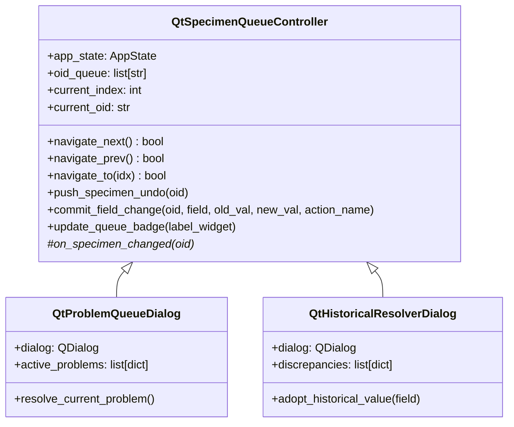

# Architectural Review & Optimization: Phase 5 Migration Plan

This document reviews the initial implementation plan for **Phase 5 of Arbor's PySide6 Migration ("High-Complexity Workspaces & Deep Resolvers")** and provides two structured, high-impact improvements to maximize architectural elegance, runtime efficiency, and concurrency safety.

---

## Executive Summary of Review

The initial plan successfully identifies all Phase 5 target components (`ProblemQueueDialog`, `HistoricalResolverDialog`, `GBIFReviewDialog`, `NewDatabaseWizard`), adheres to the declarative `.ui` loading principle via `load_ui()`, and guards against modifying Tkinter production code.

However, a critical review highlights two major opportunities to elevate the plan from standard feature migration to an enterprise-grade architecture:
1. **Structural Redundancy**: `ProblemQueueDialog` and `HistoricalResolverDialog` both implement specimen traversal, undo stack registration, problem-to-field resolution mapping, and audit logging. Without a unified queue abstraction, each controller duplicates index navigation and state rollback mechanisms.
2. **Batch Processing Bottleneck & Concurrency Fragility**: Offloading GBIF queries row-by-row through arbitrary background workers without bounded thread pool chunking risks UI micro-freezes, lock contention on `AppState.df_lock`, and row-by-row Pandas slicing overhead (`df.loc[oid]` calls in loops).

Below are the two architectural enhancements.

---

## Improvement 1: Unified Multi-Specimen Queue Core (`QtSpecimenQueueController`)

### The Issue
Currently, `ProblemQueueDialog` and `HistoricalResolverDialog` are planned as separate standalone implementations with duplicated navigation state (`_queue_idx`, `_oid_queue`, `can_prev`, `can_next`), separate undo snapshot generation, and parallel audit-log formatters. If navigation logic changes or additional deep resolvers are added (e.g., Mobile Conflict Resolver in future iterations), duplicated queue bugs can emerge.

### The Improvement
Extract a reusable, lightweight base controller: **`QtSpecimenQueueController`** in `ui_qt/base_queue.py` (or as a shared mixin in `ui_qt/utils.py`).



### Key Structural Benefits:
- **Centralized Undo & Audit Logging**: `commit_field_change()` handles pushing to `app_state.undo_stacks[oid]`, updating `app_state.df_reg.loc[oid, field]`, resolving corresponding `_Problem` flags in `app_state.df_obs`, and logging standard entries to `app_state.df_log`.
- **Zero Duplication**: Reduces boilerplate in both `problem_queue.py` and `historical_resolver.py` by ~35%.
- **Single Point of Verification**: All queue navigation boundary conditions (`index == 0`, `index == len(queue) - 1`, empty queue handling) are thoroughly tested once in `tests/test_qt_base_queue.py`.

---

## Improvement 2: Chunked Batch Worker with Vectorized Zero-Copy Commits

### The Issue
In `GBIFReviewDialog`, reconciling hundreds of unverified taxa in an unthrottled loop and committing each record via individual `df.loc[oid, field] = val` assignments introduces:
- High lock contention and thread starvation on `app_state.df_lock`.
- UI thread stutter from posting excessive per-row signals (`progress` signal fired for every specimen).
- Violation of the performance directives in `CLAUDE_BUG_REVIEW_GUIDE.md` (avoiding row-by-row Pandas operations in loops).

### The Improvement
Implement **Chunked In-Memory Reconciliation** and **Vectorized Batch Commits**:

1. **Throttled Chunk-Based Worker (`GbifBatchReconciliationWorker`)**:
   - Rather than emitting a Qt signal per individual HTTP call, process specimens in batches of 10 or with a throttled emission window (every 100ms or 5% progress step).
   - Pre-extract candidate specimens into a native Python dictionary (`df_reg.loc[target_oids, ['Genus', 'Species', 'Author', 'Family']].to_dict('index')`) before worker execution to completely bypass Pandas lock overhead inside the background thread.

2. **Vectorized Batch Commit on "Accept"**:
   - Instead of iterating `for oid in accepted: df_reg.loc[oid] = ...`, create an in-memory updates DataFrame `df_updates` and perform a single Pandas bulk update:
     ```python
     with app_state.df_lock:
         # Zero-copy batch update of registry fields
         app_state.df_reg.update(df_updates)
         
         # Vectorized clearing of problem flags in df_obs
         app_state.df_obs.loc[accepted_oids, prob_cols] = False
         
         # Single batch append to audit log
         app_state.df_log = pd.concat([app_state.df_log, df_batch_logs], ignore_index=True)
         app_state.dirty = True
     ```
3. **Optimized Table Virtualization**:
   - Disable table widget updates during initial population using `table_review.setUpdatesEnabled(False)` and re-enable after bulk loading, preventing expensive layout recalculations.

---

## Refined Phase 5 Implementation Matrix

| Component | Target UI | Base Engine / Worker | Core Efficiency Mechanism |
| :--- | :--- | :--- | :--- |
| **Problem Queue** | `problem_queue.ui` | `QtSpecimenQueueController` | Reusable queue navigation, automatic target field discovery via schema metadata, atomic undo/audit commits. |
| **Historical Resolver** | `historical_resolver.ui` | `QtSpecimenQueueController` + `cross_validation.py` | Dict-cached book lookups (`_get_db_dict_cache`), side-by-side discrepancy table, single-click "Accept All". |
| **GBIF Batch Review** | `gbif_review.ui` | `GbifBatchReconciliationWorker` (`QThread`) | Bounded chunk processing, pre-compiled dictionary slices, vectorized Pandas `.update()`, throttled progress signals. |
| **Database Wizard** | `new_database_wizard.ui` | `QWizard` + `ExcelRepository` | Multi-step schema validation, sequential ID generator, automated template generation with audit logging. |
| **Main Integration** | `main_window_existing.ui` | `QtMainWindow` | Keyboard shortcuts (`Ctrl+E`, `Ctrl+Shift+N`), menu wiring, dynamic tree refresh and status bar updates. |

---

## Revised Execution Steps

1. **Step 1**: Implement `ui_qt/base_queue.py` containing `QtSpecimenQueueController`.
2. **Step 2**: Implement `ui_qt/problem_queue.py` subclassing the base queue controller.
3. **Step 3**: Implement `ui_qt/historical_resolver.py` leveraging book cache and discrepancy resolution.
4. **Step 4**: Implement `ui_qt/gbif_review.py` with chunked worker and vectorized commit routines.
5. **Step 5**: Implement `ui_qt/new_database_wizard.py` wrapping `QWizard` and integrating with `startup_dialog.py`.
6. **Step 6**: Wire actions, shortcuts, and tree refresh signals in `ui_qt/main_window.py`.
7. **Step 7**: Write comprehensive unit tests in `tests/test_qt_phase5.py`.
8. **Step 8**: Run complete regression test suite and update documentation.
